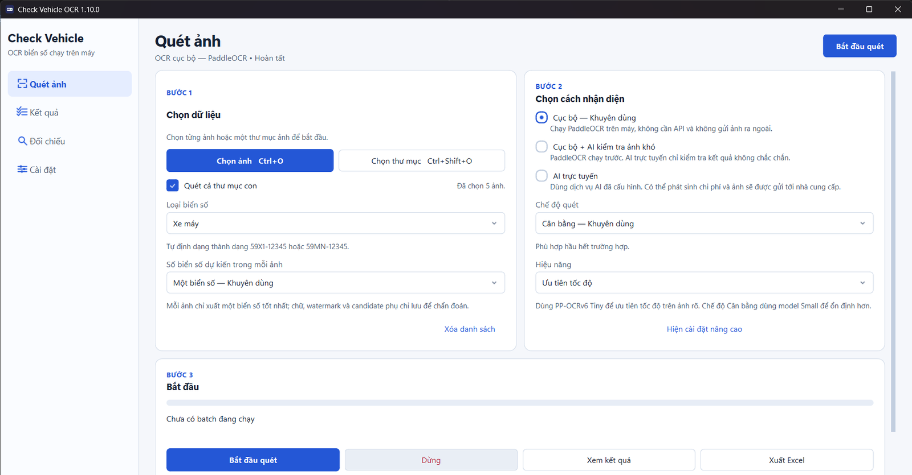

# Check Vehicle OCR

Ứng dụng Windows đọc **biển số xe** từ ảnh chụp hàng loạt, xuất kết quả ra **Excel** và đối chiếu với báo phí và phần mềm giữ xe. Toàn bộ xử lý chạy **offline** trên máy, không gửi ảnh đi đâu.

## Tính năng

- Đọc biển số Việt Nam từ một thư mục ảnh, xử lý theo lô.
- Nhận dạng offline bằng PaddleOCR chạy trên ONNX Runtime (kèm Tesseract làm phương án dự phòng).
- Xuất danh sách kết quả ra Excel.
- Đối chiếu với dữ liệu phí giữ xe để soát vé.
- Có bản cho **vé vãng lai** riêng.
- Tự kiểm tra và cập nhật bản mới ngay trong ứng dụng.

## Tải về

Vào [**Releases**](https://github.com/NovWyatt/checkparking/releases/latest) và tải:

- `CheckVehicleOCR-Setup-<phiên bản>.exe` — bản cài đặt, hoặc
- `CheckVehicleOCR-Portable-<phiên bản>.zip` — bản chạy không cần cài.

Bản cho vé vãng lai có tiền tố `CheckVehicleOCR-VeVangLai-`.

## Lưu ý khi cài

- Ứng dụng cần **key bản quyền** do quản trị viên cấp.
- Windows SmartScreen có thể cảnh báo vì bản cài chưa được ký số: bấm **More info → Run anyway**. Chỉ tải từ trang Releases này; có thể đối chiếu mã băm SHA-256 của file tải về với `SHA256SUMS.txt` đính kèm trong bản phát hành.
- Khi đã cài, kiểm tra bản mới trong mục **Cài đặt** của ứng dụng.

## Yêu cầu

- Windows 10/11 (64-bit).
- Không cần cài sẵn Microsoft Excel hay Python; bản cài đã gói đủ thành phần.

---

Kho này chỉ chứa bản phát hành. Mã nguồn không công khai.
